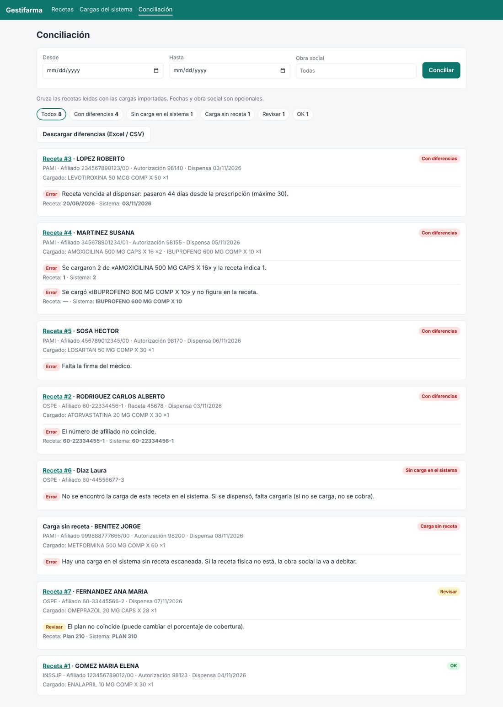

# Gestifarma

Conciliación automática entre **las recetas** y **lo que la farmacia cargó** en los sistemas de obras
sociales, gerenciadoras y colegio de farmacéuticos, para encontrar los errores **antes de presentar** y
evitar débitos.

1. **Foto de la receta** desde el celular o el escáner. La IA (Claude) lee los datos y marca lo que leyó con dudas.
2. **Reporte de lo cargado** en el sistema (CSV o Excel; más adelante, automático).
3. **Cruce automático:** bandeja con lo que está OK, lo que hay que revisar y lo que hay que corregir.



La propuesta completa (día a día, integración con los sistemas, infraestructura, costos y hoja de ruta)
está en [docs/propuesta.md](docs/propuesta.md).

## Estado

MVP para el piloto. Funciona: carga de fotos y PDF, lectura con IA, revisión manual, importación de
reportes CSV/Excel, conciliación con reglas por obra social y planilla de diferencias. Falta (ver la
hoja de ruta): conector automático real, usuarios individuales, lectura directa de códigos QR y de
barras, y la etapa posterior a la liquidación.

## Probarlo

Requiere Python 3.11 o superior.

### Demo en la terminal (sin IA ni configuración)

```bash
cd gestifarma
python -m venv .venv && source .venv/bin/activate
pip install -e .
gestifarma demo
```

Concilia 7 recetas de ejemplo contra un reporte de ejemplo y muestra cada caso: carga correcta, número
de afiliado mal cargado, receta vencida, cantidad de más y producto no recetado, falta de firma, receta
sin cargar y carga sin receta.

### La app web

```bash
cp .env.example .env        # completar usuario, clave y la clave de la API de Claude
set -a && source .env && set +a
gestifarma servidor         # http://127.0.0.1:8000
```

- Sin `ANTHROPIC_API_KEY` la app funciona igual, pero los datos de cada receta se cargan a mano.
- Para probar desde el celular en la misma red: `gestifarma servidor --host 0.0.0.0` y entrar a
  `http://IP-DE-LA-PC:8000`. Fuera de una red de pruebas, siempre detrás de HTTPS.
- Para probar la lectura con IA: subir `ejemplos/receta_sintetica.jpg` (o `gestifarma leer
  ejemplos/receta_sintetica.jpg`), importar `ejemplos/reporte_colegio_ejemplo.csv` con el formato
  `colegio-ejemplo` y conciliar.

### Con Docker

```bash
cp .env.example .env
docker compose up --build                     # http://localhost:8000

# En un servidor con dominio propio, con HTTPS automático (Caddy):
docker compose --profile https up -d --build  # requiere GESTIFARMA_DOMINIO en .env
```

## Configuración

Variables de entorno (ver [`.env.example`](.env.example)):

| Variable | Para qué |
|---|---|
| `GESTIFARMA_USUARIO`, `GESTIFARMA_CLAVE` | Acceso a la app. Sin ellas la app queda abierta: solo para pruebas locales. |
| `ANTHROPIC_API_KEY` | Activa la lectura de recetas con IA. |
| `GESTIFARMA_MODELO` | Modelo de Claude (por defecto `claude-opus-5-5`). |
| `GESTIFARMA_ESFUERZO` | `low`, `medium` (por defecto) o `high`: cuánto razona el modelo. |
| `GESTIFARMA_DATA_DIR` | Dónde se guardan la base y las fotos (por defecto `./datos`). |
| `GESTIFARMA_DATABASE_URL` | Otra base de datos, por ejemplo `postgresql+psycopg://...` (instalar con `pip install -e ".[postgres]"`). |
| `GESTIFARMA_CONFIG_DIR` | Carpeta de configuración (por defecto `./config`). |
| `GESTIFARMA_PORTAL_USUARIO`, `GESTIFARMA_PORTAL_CLAVE` | Credenciales del robot que baja reportes de un portal. |

Archivos de configuración:

- [`config/reglas.toml`](config/reglas.toml): reglas generales y por obra social (vigencia, máximo de
  medicamentos, firmas, diagnóstico, alias de nombres). Detalle de cada control en
  [docs/reglas-conciliacion.md](docs/reglas-conciliacion.md).
- [`config/fuentes/`](config/fuentes/): un archivo por formato de reporte, con qué columna tiene cada
  dato. Para un reporte nuevo se copia `colegio-ejemplo.toml` y se cambian los nombres de las columnas.
  La sección opcional `[portal]` configura el robot que lo descarga.

## Línea de comandos

| Comando | Qué hace |
|---|---|
| `gestifarma demo` | Concilia los datos de ejemplo. |
| `gestifarma servidor [--host] [--port]` | Levanta la app web. |
| `gestifarma leer FOTO [FOTO ...]` | Lee una receta (frente, dorso o PDF) con IA y muestra el JSON. |
| `gestifarma importar ARCHIVO --fuente NOMBRE` | Importa un reporte de lo cargado. |
| `gestifarma traer --fuente NOMBRE --desde AAAA-MM-DD --hasta AAAA-MM-DD` | Descarga el reporte del portal con el robot y lo importa (requiere `pip install -e ".[rpa]"` y `playwright install chromium`). |
| `gestifarma conciliar [--desde] [--hasta] [--obra-social]` | Concilia e imprime el resultado. |

## Estructura

```text
gestifarma/
├── config/
│   ├── reglas.toml              reglas de conciliación por obra social
│   └── fuentes/                 formatos de reportes (y robot opcional)
├── docs/                        propuesta, relevamiento y controles
├── ejemplos/                    recetas, reporte e imagen de ejemplo
├── src/gestifarma/
│   ├── extraccion/              lectura de recetas con Claude
│   ├── conectores/              reporte exportado (CSV/Excel) y robot (Playwright)
│   ├── conciliacion/            motor de cruce y reglas
│   ├── web/                     app web (FastAPI + plantillas)
│   ├── servicios.py             casos de uso (los usan la web y la CLI)
│   ├── modelos.py               tablas de la base de datos
│   └── cli.py                   línea de comandos
├── tests/
├── Dockerfile
└── docker-compose.yml
```

## Desarrollo

```bash
pip install -e ".[dev]"
pytest
```

Los tests no llaman a la API de Claude: usan un cliente simulado.
