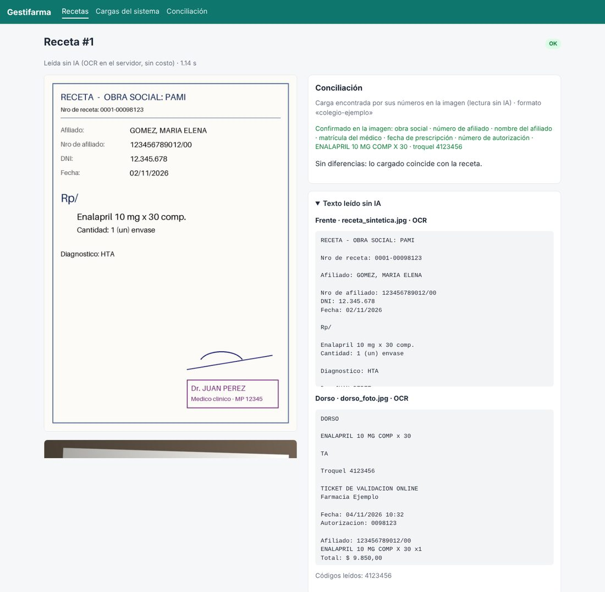

# Lectura de recetas sin costo por receta

Para vender Gestifarma a varias farmacias, leer cada receta con una IA paga por uso puede comerse el
margen. Por eso la lectura por defecto **no usa IA ni tokens**: corre en nuestro propio servidor con
herramientas gratuitas y de código abierto. La IA queda como opción a pedido, receta por receta.

## La idea

No hace falta *leer* la receta como lo haría una persona: hace falta **verificar** que lo que se cargó
en el sistema esté en la receta. Eso es mucho más fácil. En vez de interpretar campo por campo, se toma
cada dato de la carga (afiliado, matrícula, fecha, medicamento...) y se lo busca en el texto de la imagen:

| Resultado de la búsqueda | Qué significa | Cómo se muestra |
|---|---|---|
| Aparece | El dato está en la receta | Confirmado |
| Aparece uno muy parecido (un dígito distinto, otra fecha, otra obra social) | Posible diferencia, o error de lectura | Error, "confirmar en la imagen" |
| No aparece | No se pudo confirmar (letra ilegible, foto cortada) | Revisar |

La búsqueda tolera los errores típicos del OCR: confunde O con 0 o I con 1, corta un número con un
espacio ("12345678901 2/00") o pierde signos.

**Detalle importante:** los datos de la receta se buscan solo en el **frente**. El ticket de validación
del dorso lo imprime el propio sistema con lo cargado, así que confirmaría cualquier cosa. Del dorso se
usan el número de autorización, la fecha de dispensa y los troqueles.

## Cómo lee, en cascada

| Paso | Qué lee | Herramienta (código abierto) | Costo | Precisión |
|---|---|---|---|---|
| 1 | Recetas electrónicas en PDF | Texto del PDF (pypdfium2) | 0 | Exacta |
| 2 | Troqueles y códigos de recetas electrónicas | Códigos de barras y QR (zxing-cpp) | 0 | Exacta |
| 3 | Fotos y escaneos | OCR (Tesseract en español; RapidOCR como alternativa) | 0: ~1 segundo de CPU por página | Muy buena con texto impreso; mala con letra manuscrita |
| 4 | Lo cargado contra el texto | Verificación de Gestifarma | 0 | — |
| 5 (opcional) | Lo que no se pudo confirmar | IA a pedido (botón "Leer con IA") | Por receta | La mejor con letra manuscrita |

## Qué cubre y qué no

- **Cubre:** recetas electrónicas, formularios impresos, tickets de validación, sellos con la matrícula
  y troqueles con código de barras.
- **No cubre:** firmas y sellos (se controlan a la vista al armar el lote) y la letra manuscrita, que el
  OCR lee mal. Esas recetas quedan "para revisar" con la imagen al lado, o se leen con IA a pedido.

La cantidad de recetas manuscritas define cuánto trabajo manual queda. Es el dato más importante a
medir en el relevamiento: con la receta electrónica, la proporción de manuscritas debería ir bajando.

## Prueba hecha

Con una receta impresa de ejemplo, fotografiada de forma simulada (inclinada, con sombra y algo borrosa)
y con un troquel en el dorso, la lectura sin IA:

- leyó los 6 datos clave (obra social, afiliado, nombre, matrícula, fecha y medicamento con su cantidad);
- decodificó el código de barras del troquel;
- encontró la carga correcta y confirmó los 8 datos contra el reporte de ejemplo;
- tardó alrededor de 1 segundo por página, sin GPU.

Es una prueba con imágenes generadas: **hay que medirlo con recetas reales** (ver
[propuesta](propuesta.md#9-medir-la-precisión-antes-de-confiar)).

## Costos por farmacia

Estimación para una farmacia con 3.000 recetas de obra social por mes (a confirmar en el relevamiento):

| Estrategia | Costo variable por mes |
|---|---|
| Solo lectura sin IA (por defecto) | US$ 0: usa el mismo servidor |
| Sin IA + IA a pedido para el 20% más difícil, con Claude Haiku 5.5 | ~US$ 1-3 |
| Sin IA + IA a pedido para el 20% más difícil, con Claude Opus 5.5 | ~US$ 30-60 |
| IA para todas, con Claude Haiku 5.5 | ~US$ 6-15 |
| IA para todas, con Claude Opus 5.5 (como estaba antes) | ~US$ 150-300 |

El OCR usa poco procesador: 3.000 recetas por mes son 1 o 2 horas de CPU. Un servidor chico alcanza
para varias farmacias.

## Para la letra manuscrita: un modelo propio

Si el relevamiento muestra muchas recetas manuscritas, hay dos caminos sin pagar por uso:

1. **Modelo de visión de código abierto en un servidor propio con GPU.** Hay modelos abiertos que leen
   documentos y escritura a mano y corren en una placa de video de 12 a 24 GB (una PC propia o una GPU
   en la nube por hora). No tienen costo por receta, pero sí de equipo y de puesta a punto. Antes de
   usar uno hay que verificar que su licencia permita el uso comercial.
2. **Entrenar un modelo propio con nuestras recetas.** Cada receta que el backoffice revisa en
   Gestifarma queda guardada con la imagen y los datos correctos: es un ejemplo de entrenamiento gratis.
   Con algunos miles de ejemplos se puede ajustar un modelo abierto chico para recetas argentinas. Sería
   un activo propio del producto.

**Recomendación:** arrancar con la lectura sin IA (ya funciona) y medir en el piloto qué porcentaje de
recetas queda sin confirmar. Si es bajo, alcanza con revisar a mano. Si es alto, comparar el costo de la
IA a pedido (la más barata cuesta centavos por receta) con el de montar un modelo propio.

## Cómo se usa

- Viene activada: `GESTIFARMA_LECTOR=local` (también `claude` para leer todo con IA, o `manual`).
- Motor de OCR: `GESTIFARMA_OCR=tesseract` (por defecto) o `rapidocr` (`pip install -e ".[rapidocr]"`).
  En las pruebas, Tesseract leyó mejor el texto en español.
- Tesseract ya viene en la imagen de Docker. Para correr sin Docker hay que instalarlo: en Debian o
  Ubuntu `apt-get install tesseract-ocr tesseract-ocr-spa`; en macOS `brew install tesseract tesseract-lang`.
- En la ficha de cada receta se ve el texto leído, qué se confirmó en la imagen y, si hay clave de la
  API, el botón "Leer con IA".
- Desde la terminal: `gestifarma leer foto.jpg` (sin IA) o `gestifarma leer foto.jpg --ia`.
