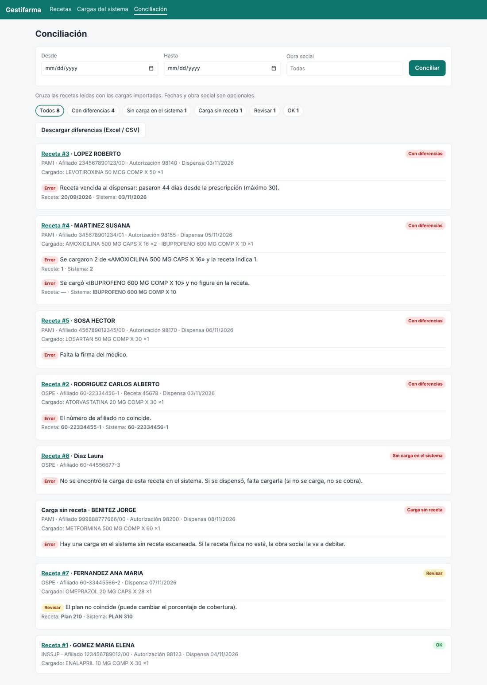
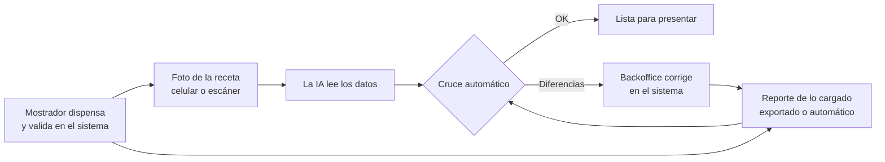
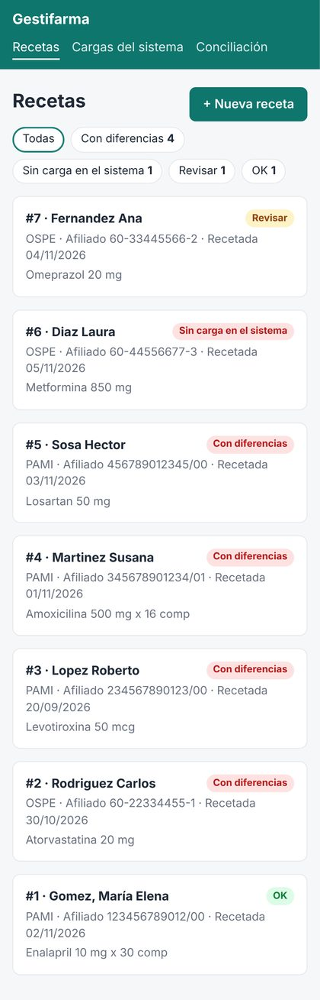
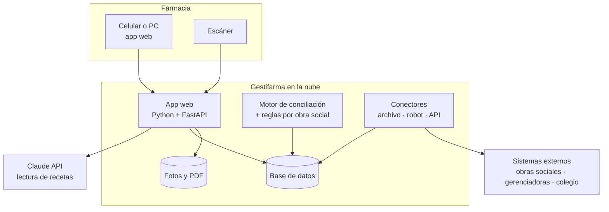
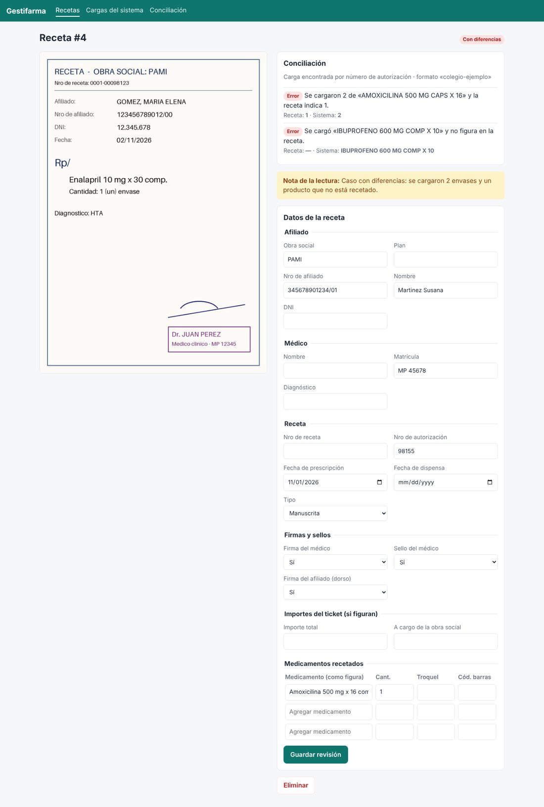

# Gestifarma: propuesta

> Propuesta inicial para discutir con la farmacia. Lo marcado como *a confirmar* depende del
> [relevamiento](relevamiento.md).

## 1. El problema

Cuando la farmacia dispensa una receta de obra social, alguien carga los datos en un sistema (el de la
obra social, el de la gerenciadora o el del colegio de farmacéuticos) para que después se la paguen.
Antes de presentar el lote, el backoffice controla a mano que lo cargado coincida con la receta:
afiliado, médico, fechas, medicamentos, cantidades, firmas, troqueles.

Ese control es lento y se escapan errores. Cada error que se escapa termina en un **débito** (la obra
social no paga esa receta o la paga de menos) y cada receta que no se cargó es plata que no se cobra.

## 2. Qué proponemos

Un sistema que haga el control y le deje al backoffice solo las excepciones:

1. **Foto de la receta** desde el celular (o escáner). La IA lee los datos.
2. **Lo cargado en el sistema** entra a Gestifarma: al principio con el reporte que exporta el sistema;
   después, de forma automática.
3. **Cruce automático** campo por campo. Resultado: una bandeja con lo que está bien, lo que hay que
   mirar y lo que hay que corregir **antes de presentar**.

La idea no es reemplazar al backoffice: es que deje de revisar 100 recetas para encontrar las 10 que
tienen problemas.

## 3. El día a día

| Momento | Quién | Qué hace | Esfuerzo |
|---|---|---|---|
| Al dispensar o al cierre del día | Mostrador o backoffice | Saca foto del frente, y del dorso si tiene firma, troqueles o ticket. Desde el celular, con la app web. | ~10 segundos por receta |
| Automático | Gestifarma | La IA lee la receta y marca lo que leyó con dudas. | — |
| Una vez por día, o antes de cerrar cada lote | Backoffice | Baja del sistema el reporte de lo cargado y lo sube (hasta que esté automatizado). | 2-3 minutos |
| Automático | Gestifarma | Cruza todo y arma la bandeja. | — |
| Antes de presentar | Backoffice | Mira solo lo marcado: corrige la carga, consigue la firma que falta, etc. Puede bajar la planilla de diferencias. | Solo las excepciones |

- **Mucho volumen:** un escáner de documentos con alimentador automático y doble faz, configurado para
  guardar un PDF por receta, es más rápido que el celular. Se suben todos juntos ("Varias recetas a la
  vez").
- **Recetas electrónicas:** las que llegan en PDF se suben tal cual; la lectura es más confiable que la
  de una foto.

## 4. Arquitectura

| Pieza | Qué hace | Tecnología | Estado |
|---|---|---|---|
| App web | Fotos, bandeja, revisión, importación de reportes y conciliación. Se agrega a la pantalla del celular como una app, sin pasar por las tiendas. | FastAPI + HTML | MVP hecho |
| Lectura de recetas | Manda las imágenes a la IA y recibe los datos en un formato fijo y validado, con los campos dudosos marcados. | Claude (visión + salida estructurada) | Hecho |
| Conectores | Traen lo cargado: reporte exportado (CSV o Excel), robot que baja ese reporte del portal, API cuando exista. | csv / openpyxl, Playwright | Archivo: hecho · Robot: plantilla · API: a definir |
| Motor de conciliación | Encuentra la carga de cada receta y compara campo por campo. | Python | Hecho |
| Reglas | Vigencia, máximo de medicamentos, firmas, diagnóstico y alias de obras sociales, por obra social. | `config/reglas.toml` | Hecho (valores a confirmar) |
| Base de datos | Recetas, cargas y resultados. | SQLite en el piloto; PostgreSQL con varias farmacias | Hecho |
| Fotos y PDF | Se guardan los originales: son la evidencia ante un reclamo. | Disco; almacenamiento de objetos más adelante | Hecho (disco) |

Decisiones de diseño:

- **App web y no app nativa:** no hay que publicar en tiendas ni instalar nada, funciona en cualquier
  celular con cámara y hay una sola base de código.
- **IA en vez de OCR tradicional:** las recetas son manuscritas y cada obra social tiene su formato. Un
  OCR clásico devuelve texto suelto y hay que programar dónde está cada dato; la IA devuelve directamente
  los campos (afiliado, médico, medicamentos...) y dice qué leyó con dudas.
- **El motor no depende de cómo llegan los datos:** da lo mismo si la carga vino de un Excel, de un
  robot o de una API. Se puede arrancar ya y mejorar la integración después sin tocar el resto.
- **Reglas en configuración, no en el código:** cuando cambia un convenio se edita un archivo.

## 5. Cómo nos conectamos al sistema de la gerenciadora o del colegio

Todavía no sabemos cómo es ese sistema. Hay cuatro caminos, del más simple al más complejo:

| Opción | Cómo funciona | A favor | En contra | Cuándo |
|---|---|---|---|---|
| **A. Reporte exportado** (CSV o Excel) | Alguien baja el reporte de lo cargado y lo sube a Gestifarma. Ya está implementado. | Funciona desde el primer día con cualquier sistema. No hay que guardar credenciales. | Un paso manual de 2-3 minutos. | **Para arrancar** |
| **B. Sistema de gestión de la farmacia** | Exportar las dispensas desde el software de la farmacia (donde se valida) o leer su base de datos. | Suele tener todo, incluidos los números de autorización. A veces es más fácil que el portal externo. | Depende del proveedor del software. | Averiguar en el relevamiento |
| **C. API o webservice** | La gerenciadora o el colegio ofrece un servicio para consultar las cargas. | Automático, estable y oficial. | Pocas lo ofrecen; suelen pedir convenio. | Preguntar ya; implementar si existe |
| **D. Robot (RPA) con usuario y contraseña** | Un navegador automático entra al portal y baja el mismo reporte de la opción A. Hay una plantilla en el repo. | Automatiza sin depender del proveedor. | Se rompe si cambia el portal; un captcha o el doble factor lo pueden frenar; hay que revisar los términos de uso y guardar credenciales. | Si no hay API y el paso manual molesta |

**Recomendación:** arrancar con **A**, averiguar **B** y **C** en el relevamiento y dejar **D** para
cuando el piloto haya demostrado el valor. Si se usa el robot:

- que descargue el reporte y no que "lea la pantalla": reutiliza el mismo importador y se rompe menos;
- solo lectura, idealmente con un usuario propio para el robot;
- credenciales en un gestor de secretos, nunca en el código;
- con autorización escrita de la farmacia y revisando los términos de uso del portal;
- si el portal solo acepta conexiones desde la red de la farmacia, el robot corre en una PC de la
  farmacia (infraestructura híbrida, sección 6).

Si el sistema solo exporta PDF, la misma IA que lee las recetas puede leer ese PDF y convertirlo en datos.

## 6. Infraestructura: ¿en la farmacia o en la nube?

| | En la farmacia (servidor local) | Nube administrada por nosotros | Híbrida |
|---|---|---|---|
| Inversión inicial | PC o servidor, UPS, backup | Ninguna | Ninguna (usa una PC que ya existe) |
| Costo mensual | Luz y mantenimiento | ~US$ 20-40 en el piloto, más la IA | Igual que la nube |
| Actualizaciones y backups | La farmacia, o nosotros por acceso remoto | Nosotros, centralizado | Nosotros |
| Usar el celular fuera de la farmacia | Hace falta una VPN | Directo, con usuario y clave | Directo |
| Si se corta internet en la farmacia | La app sigue andando, pero la lectura con IA no (necesita internet igual) | No se pueden subir fotos hasta que vuelva | Igual que la nube |
| Datos de salud fuera de la farmacia | No | Sí (sección 8) | Sí |
| Sumar otras farmacias | Una instalación por farmacia | El mismo sistema para todas | El mismo sistema + un agente por farmacia |
| Robot en portales que filtran por IP | Funciona | Puede no funcionar | El agente local corre el robot |

**Recomendación: nube administrada por nosotros**, sumando un agente local solo si el robot lo necesita.

- La farmacia no mantiene servidores ni hace backups, y el backoffice puede usar el celular desde
  cualquier lugar.
- La lectura con IA necesita internet de todas formas: un servidor local no saca esa dependencia.
- Si el producto funciona, el mismo sistema sirve para otras farmacias como servicio mensual.

En dos etapas:

1. **Piloto (una farmacia):** una máquina virtual chica (2 vCPU, 4 GB de RAM) con Docker Compose: la
   app, la base SQLite y las fotos en el disco, HTTPS automático con Caddy (ya incluido en
   `docker-compose.yml`) y un backup diario a un almacenamiento de objetos. Se levanta en cualquier
   proveedor (Google Cloud, AWS, DigitalOcean, etc.). Los grandes proveedores no tienen región en
   Argentina; las más cercanas suelen ser San Pablo o Santiago de Chile.
2. **Varias farmacias:** servicios administrados (por ejemplo Cloud Run + Cloud SQL + Cloud Storage en
   Google Cloud, o el equivalente en AWS), PostgreSQL, datos separados por farmacia, usuarios
   individuales y monitoreo. Del orden de US$ 60-150 por mes de base, más la IA según el volumen.

## 7. Costo de la IA

Estimación cada 1.000 recetas, con foto de frente y dorso:

| Modelo | Costo aproximado cada 1.000 recetas | Comentario |
|---|---|---|
| Claude Opus 5.5 (el configurado por defecto) | US$ 50-100 | El más preciso de los tres; recomendado para el piloto |
| Claude Sonnet 5.5 | US$ 25-50 | Comparar con el set de prueba |
| Claude Haiku 5.5 | US$ 2-5 | Probar si alcanza, sobre todo para recetas impresas o electrónicas |

Supuestos: hasta ~4.800 tokens por imagen a la máxima resolución útil, ~1.500 tokens de instrucciones y
1.500-2.500 tokens de respuesta (incluido el razonamiento del modelo). Precios por millón de tokens a
noviembre de 2026 (entrada / salida): Opus 5.5 US$ 4 / 20; Sonnet 5.5 US$ 2 / 10; Haiku 5.5
US$ 0,10 / 0,50. Si la lectura no es urgente se puede procesar en lote a mitad de precio.

El consumo real queda guardado en cada receta, así que en el piloto vamos a tener el número exacto. Para
ponerlo en perspectiva: alcanza con evitar unos pocos débitos por mes para pagar la lectura de miles de
recetas. El monto de débitos de los últimos meses (relevamiento) da la cuenta real. El modelo se cambia
con una variable (`GESTIFARMA_MODELO`).

## 8. Seguridad y datos personales

- **Son datos de salud.** Para la Ley 25.326 de protección de datos personales son datos sensibles: hay
  que aplicar medidas de seguridad acordes, registrar la base ante la autoridad de control (AAIP) y
  definir quién accede y por cuánto tiempo se guardan. *A validar con asesoría legal antes de pasar a
  producción.*
- **Datos fuera del país.** La nube y la API de IA procesan los datos fuera de Argentina, y la ley pone
  condiciones a esas transferencias (por ejemplo, cláusulas contractuales). Revisarlo con el asesor
  legal junto con las condiciones de los proveedores. Según sus condiciones comerciales, Anthropic no
  usa los datos enviados por la API para entrenar modelos; igual hay que revisar los plazos de retención
  y, si hace falta, firmar un acuerdo de procesamiento de datos.
- **Lo que ya hace el MVP:** acceso con usuario y clave; fotos visibles solo para usuarios autenticados;
  rechazo de formularios enviados desde otros sitios; credenciales en variables de entorno.
- **Lo que falta para producción:** HTTPS siempre (ya preparado con Caddy), usuarios individuales con
  roles y registro de quién hizo qué, doble factor, backups cifrados y una política de retención (por
  ejemplo, borrar las fotos después de cierto tiempo).

## 9. Medir la precisión antes de confiar

La lectura con IA no es perfecta, sobre todo con letra manuscrita. Antes de confiar en ella:

1. Armar un set de 50-100 recetas reales (fotos) con los datos correctos cargados por el backoffice en
   una planilla.
2. Medir campo por campo cuánto acierta: afiliado, matrícula, fechas, medicamentos y cantidades.
3. Ajustar las instrucciones y probar otros modelos con el mismo set; comparar costo y precisión.
4. Decidir qué campos se aceptan sin mirar y cuáles se revisan siempre.

Mientras tanto el sistema ya ayuda: los campos dudosos y todas las diferencias se muestran con la imagen
al lado, para confirmar en segundos.

## 10. Hoja de ruta

| Etapa | Duración estimada | Qué incluye | Resultado |
|---|---|---|---|
| 0. Relevamiento | 1-2 semanas | [Preguntas](relevamiento.md); recetas de muestra, reportes del sistema y el detalle de débitos de los últimos meses. | Sabemos cómo conectarnos y qué reglas aplicar. |
| 1. Piloto | 3-4 semanas | Este MVP en la nube para una farmacia: fotos + reporte exportado + conciliación. Formatos y reglas reales. Medición de precisión. | Primeros débitos evitados y números para decidir. |
| 2. Automatización | 4-6 semanas | Conector automático (API o robot); lectura directa de códigos QR y de barras (recetas electrónicas y troqueles); base de medicamentos para comparar nombres comerciales con la droga recetada; usuarios individuales; procesamiento en lote. | El backoffice solo saca fotos y revisa excepciones. |
| 3. Después de la liquidación | 3-4 semanas | Cruzar las liquidaciones y los débitos con lo presentado: qué se debitó, por qué y qué se puede reclamar o refacturar. Tablero de débitos por causa. | Se recupera plata y se ataca la causa de los débitos. |
| 4. Varias farmacias | A definir | Datos separados por farmacia, alta de clientes, facturación, panel por farmacia. | Producto para ofrecer a otras farmacias. |

## 11. Decisiones a tomar

1. **Infraestructura:** ¿vamos con la nube administrada por nosotros? (recomendado)
2. **Qué sistema cruzar primero:** colegio, gerenciadora o sistema de gestión de la farmacia (sale del
   relevamiento).
3. **Quién saca las fotos y cuándo:** en el mostrador al dispensar o en el backoffice al cierre.
4. **Modelo de IA y presupuesto mensual para el piloto** (recomendado: Opus 5.5, el configurado).
5. **Revisión legal** de datos de salud y transferencia internacional.
